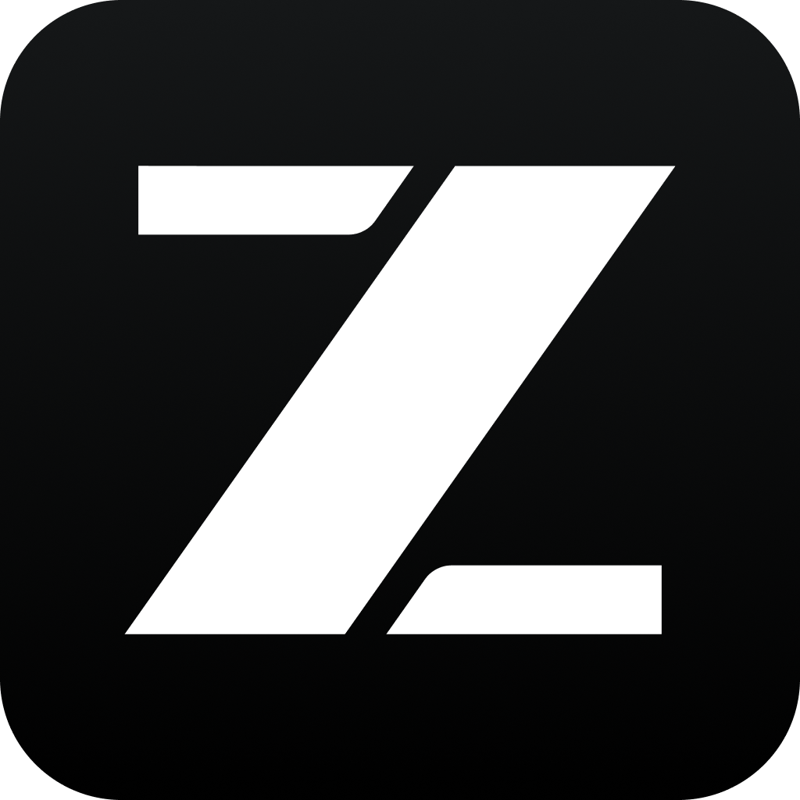

# RobinRun

<div align="center">
  
</div>
<p align="center">
  <a href="README.md">简体中文</a> | English
</p>

RobinRun is a **fully automated online operations harness**: multiple agents collaborate across browser operations, information gathering, comment replies, trigger-driven responses, and product feedback loops.

> Deeply forked from [ZCode](https://github.com/zai-org/ZCode) (Apache-2.0), with a full rebrand and an in-progress multi-agent architecture rework. The upstream design docs remain in [docs/](docs/) and [specs/](specs/).

## Product Shape

- **Project-based workspaces**: the app starts at a project launcher; create or pick an operations project and it owns the main window
- **Three-pane layout**: agent list with collapsible sessions (left), conversation area (center), info panels for web pages and file trees (right)
- **Multi-agent hierarchy**: main Agent → resident agents (dev/ops) → ephemeral sub-agents; triggers wake agents automatically; cross-agent communication is routed via the main Agent; major decisions require "todo + email + human approval"
- **Bring your own LLM**: inherits ZCode's provider system

## Status (P1 done, Nov 2026)

- ✅ Fork of ZCode v3.17.2, fully rebranded to RobinRun (package scope `@robinrun/*`)
- ✅ Project launcher as the cold-start gate (login flow hidden, own auth to be added later)
- ✅ Agents sidebar: agent grouping with collapsible session lists
- 🚧 Session data structure rework (in progress)
- 📋 Planned: resident multi-agent runtime, trigger system, content review flow, task system, meetings, email notifications, operations backend

## Development

Requires Git, Node.js **≥ 24**, pnpm **10.33.2** (see [mise.toml](mise.toml)).

```bash
pnpm bootstrap     # install deps + prepare desktop runtime assets + full build
pnpm dev:desktop   # start the desktop app in dev mode
pnpm typecheck     # type check
pnpm lint          # lint
```

See [AGENTS.md](AGENTS.md) for repository structure, architecture rules, and collaboration notes.

## License

Dual licensing:

- **RobinRun's original additions**: [MIT](LICENSE-MIT)
- **Code derived from upstream ZCode**: [Apache-2.0](LICENSE) (its legal grant cannot be changed)

Third-party notices: [NOTICE.md](NOTICE.md) and [THIRD-PARTY-NOTICES.md](THIRD-PARTY-NOTICES.md).
